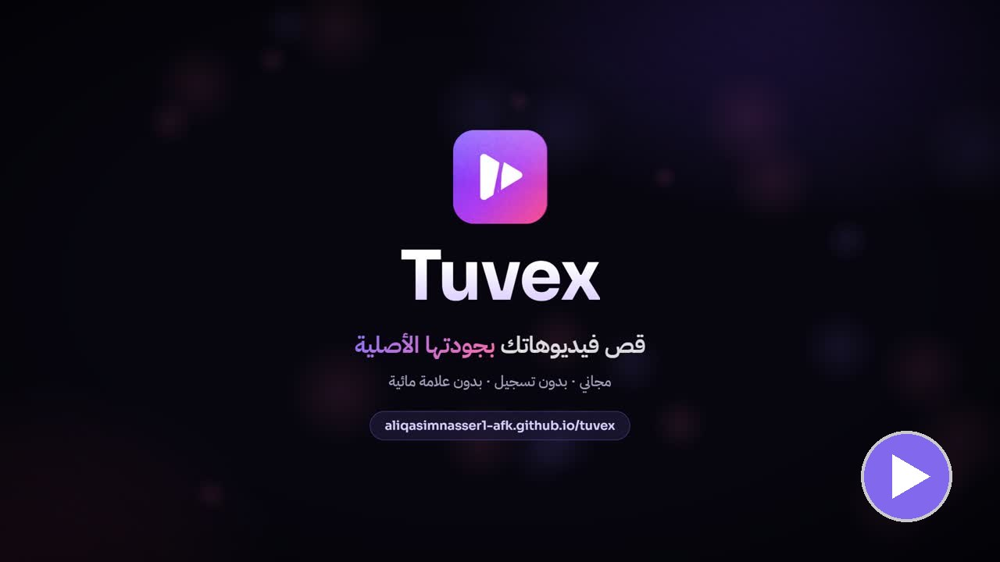

### قص الفيديو أونلاين بجودته الأصلية

قص، قسّم، اكتم الصوت، أو صغّر الحجم. كل شي يصير داخل جهازك، والفيديو ما يترفع لأي مكان.

**[🎬 افتح الموقع](https://aliqasimnasser1-afk.github.io/tuvex/)**

`https://aliqasimnasser1-afk.github.io/tuvex/`

---

## شاهد الفيديو

**[▶️ شغّل الفيديو](https://aliqasimnasser1-afk.github.io/tuvex/assets/promo/tuvex_promo.mp4)** · 54 ثانية

## المميزات

| | الميزة | التفاصيل |
|---|---|---|
| ✂️ | **قص بالجودة الأصلية** | بدون إعادة ترميز، فيخلص خلال ثواني حتى في الفيديوهات الطويلة |
| 🗜️ | **ضغط وتصغير الحجم** | 1080p أو 720p أو 480p، مع قص دقيق بالثانية |
| 🧩 | **تقسيم الفيديو** | لعدد أجزاء تختاره، أو جزء كل عدد ثواني تحدده |
| 🔇 | **إزالة الصوت** | بضغطة زر، مع القص أو التقسيم |
| 🔒 | **خصوصية كاملة** | المعالجة داخل متصفحك، والفيديو ما يترفع لأي سيرفر |
| ⚡ | **وضع سريع** | محرك متعدد الأنوية يخلي الضغط أسرع 2.3 مرة تقريبًا |
| 📱 | **كل الأجهزة** | جوال، تابلت، وكمبيوتر، ويتثبت كتطبيق على الشاشة الرئيسية |
| 🌙 | **وضع ليلي ونهاري** | يتبع إعدادات جهازك، أو تختار بنفسك |
| 🆓 | **مجاني** | بدون تسجيل، وبدون علامة مائية |

## الصيغ المدعومة

MP4 · MOV · WEBM · MKV · AVI · TS · 3GP · FLV وغيرها

## مبني بـ

[ffmpeg.wasm](https://github.com/ffmpegwasm/ffmpeg.wasm) · HTML · CSS · JavaScript
